# Pipeline CI/CD con Terraform, GitHub Actions y AWS mediante Autenticación Federada OIDC

> Proyecto práctico de **Infrastructure as Code (IaC)** y automatización **DevOps** desarrollado por **Ronald Villacorta**.


---

## Descripción del Proyecto

Este proyecto implementa un ciclo de vida completo de **Infraestructura como Código (IaC)** para desplegar una arquitectura de red robusta (Virtual Private Cloud - VPC) en Amazon Web Services (AWS) mediante **Terraform**, automatizando su validación y despliegue a través de un pipeline de **GitHub Actions**.

A diferencia de implementaciones convencionales basadas en claves estáticas (`AWS_ACCESS_KEY_ID` y `AWS_SECRET_ACCESS_KEY`), este proyecto adopta el estándar de seguridad empresarial recomendado por AWS y GitHub: **autenticación federada basada en OpenID Connect (OIDC)** con roles IAM asumibles temporalmente (*passwordless CI/CD*).

Asimismo, el proyecto resuelve desafíos avanzados de ingeniería DevOps:
* **Gestión de estado remoto en Amazon S3** con control de versiones y bloqueo nativo mediante `use_lockfile = true`.
* **Vendorización y desacoplamiento de infraestructura** utilizando módulos de red del Terraform Registry.
* **Resolución técnica de discrepancias en tokens JWT OIDC**, específicamente los nuevos identificadores inmutables de GitHub (*Immutable Subject Claims*).
* **Políticas IAM de mínimo privilegio** diseñadas específicamente para operaciones de lectura, escritura y bloqueo del backend de Terraform.

---

## Índice

1. [Arquitectura del Proyecto](#arquitectura-del-proyecto)
2. [Fase 1: Configuración del Entorno Local y Provider](#fase-1-configuración-del-entorno-local-y-provider)
3. [Fase 2: Backend Remoto en Amazon S3 con Bloqueo Nativo](#fase-2-backend-remoto-en-amazon-s3-con-bloqueo-nativo)
4. [Fase 3: Aprovisionamiento de Red (VPC) mediante Módulos](#fase-3-aprovisionamiento-de-red-vpc-mediante-módulos)
5. [Fase 4: Preparación y Versionado en Git](#fase-4-preparación-y-versionado-en-git)
6. [Fase 5: Diseño del Pipeline CI/CD con GitHub Actions](#fase-5-diseño-del-pipeline-cicd-con-github-actions)
7. [Fase 6: Autenticación Segura sin Claves mediante AWS OIDC e IAM](#fase-6-autenticación-segura-sin-claves-mediante-aws-oidc-e-iam)
8. [Fase 7: Diagnóstico de Errores y Soluciones Técnicas (Troubleshooting)](#fase-7-diagnóstico-de-errores-y-soluciones-técnicas-troubleshooting)
   - [8.1 Error 1: Validación del audience en el token OIDC](#81-error-1-validación-del-audience-en-el-token-oidc)
   - [8.2 Error 2: Desajuste del claim `sub` por identificadores inmutables de GitHub](#82-error-2-desajuste-del-claim-sub-por-identificadores-inmutables-de-github)
   - [8.3 Error 3: Acceso denegado (403 Forbidden) en S3 HeadObject durante `terraform init`](#83-error-3-acceso-denegado-403-forbidden-en-s3-headobject-durante-terraform-init)
   - [8.4 Diagnóstico sin Docker: inspección de JWT en el Runner](#84-diagnóstico-sin-docker-inspección-de-jwt-en-el-runner)
9. [Fase 8: Validación de Ejecución y Pruebas de Cambio](#fase-8-validación-de-ejecución-y-pruebas-de-cambio)
10. [Estructura del Repositorio](#estructura-del-repositorio)
11. [Decisiones Técnicas Relevantes](#decisiones-técnicas-relevantes)
12. [Lecciones Aprendidas para Ingeniería DevOps](#lecciones-aprendidas-para-ingeniería-devops)
13. [Posibles Mejoras y Roadmap hacia Producción](#posibles-mejoras-y-roadmap-hacia-producción)
14. [Referencias Oficiales](#referencias-oficiales)

---

## Arquitectura del Proyecto

El siguiente diagrama detalla la integración entre el repositorio en GitHub, el pipeline automatizado con GitHub Actions mediante tokens efímeros OIDC, el backend remoto en S3 y la infraestructura de red desplegada en AWS:

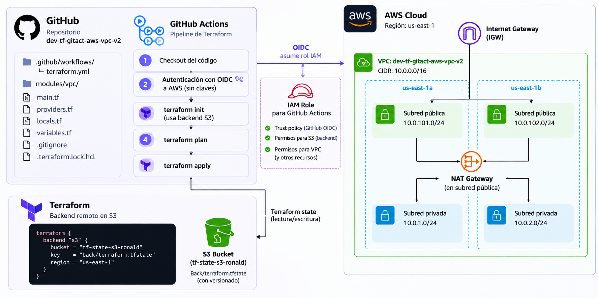

### Flujo de Operación

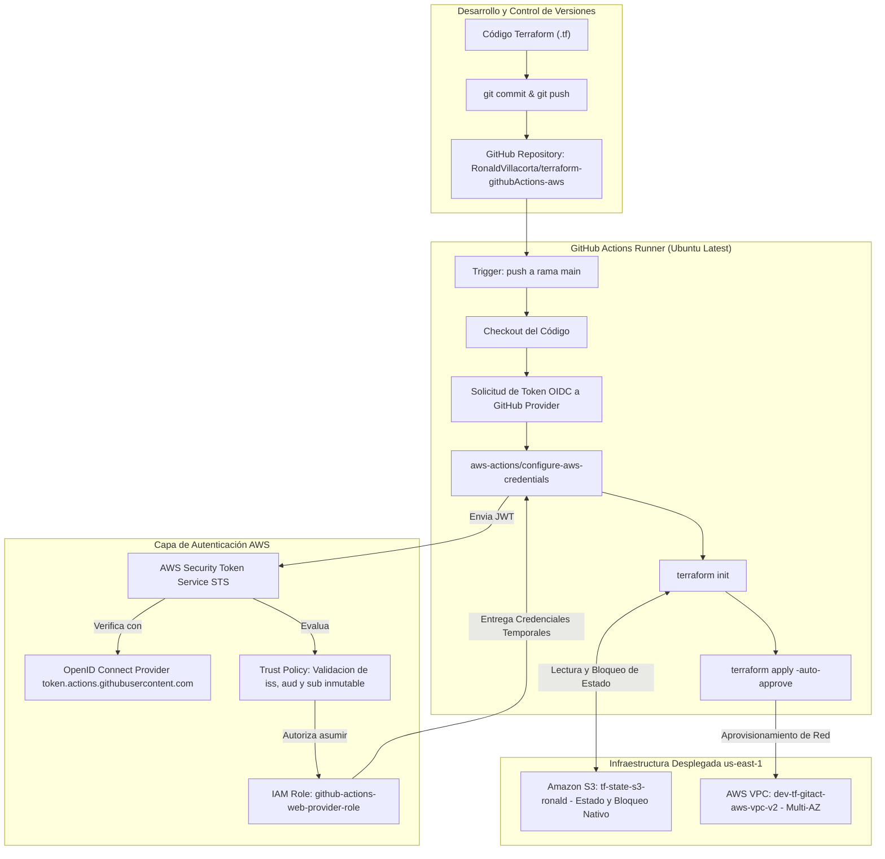

---

## Fase 1: Configuración del Entorno Local y Provider

Antes de automatizar el despliegue en un entorno desatendido de CI/CD, se establece y valida la infraestructura en el entorno local del desarrollador.

### 1.1 Autenticación inicial con AWS CLI

Se verifica la sesión local mediante el comando `sts get-caller-identity`:

```bash
aws sts get-caller-identity
```


La consola confirma que la identidad activa corresponde al usuario `Ronald` en la cuenta `336203085137`.

### 1.2 Declaración del Provider de AWS

Se consulta la documentación oficial del [Terraform Registry — AWS Provider](https://registry.terraform.io/providers/hashicorp/aws/latest/docs):

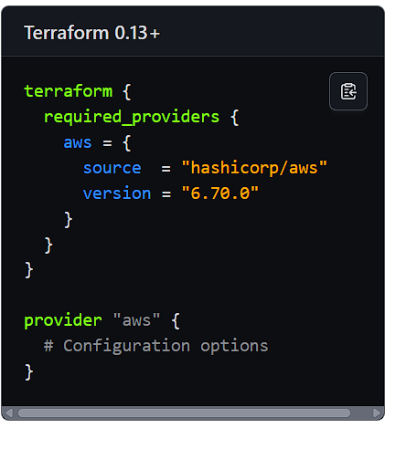

Se crea el archivo `provider.tf` fijando las versiones requeridas y configurando etiquetas globales (*default tags*) mediante variables locales:

```hcl
terraform {
  required_version = ">= 1.16.6"
  required_providers {
    aws = {
      source  = "hashicorp/aws"
      version = "6.70.0"
    }
  }
}

provider "aws" {
  default_tags {
    tags = local.tags
  }
}
```

En `locals.tf` se centralizan las etiquetas y variables organizacionales:

```hcl
locals {
  enviroment = "dev"
  region     = "us-east-1"
  project    = "tf-gitact-aws"
  prefix     = "${local.enviroment}-${local.project}"

  tags = {
    Owner       = "Ronald"
    Environment = local.enviroment
    ManagedBy   = "Terraform"
    Project     = local.project
  }
}
```

> **Decisión de seguridad:** Las credenciales nunca se colocan dentro del código HCL. Terraform utilizará de forma transparente el perfil local de AWS CLI en desarrollo y variables de entorno o roles OIDC en GitHub Actions.

---

## Fase 2: Backend Remoto en Amazon S3 con Bloqueo Nativo

El archivo `terraform.tfstate` mantiene la relación entre el código y los recursos aprovisionados. Dado que los *runners* de GitHub Actions son máquinas virtuales efímeras que se destruyen tras cada ejecución, el estado debe persistirse en un almacenamiento remoto centralizado.

### 2.1 Creación del Bucket S3

Se crea un bucket S3 de propósito general en la región `us-east-1` denominado:

```text
tf-state-s3-ronald
```

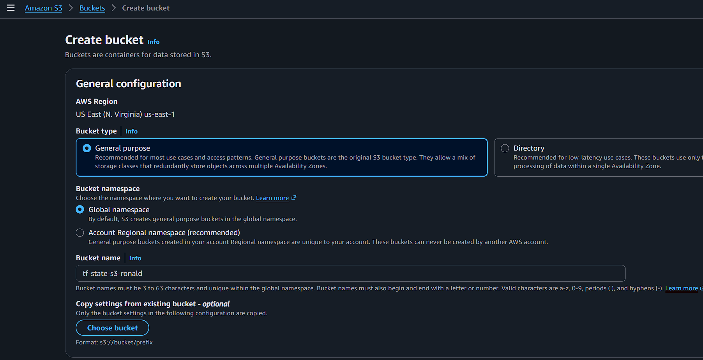

### 2.2 Control de Versiones

Se habilita el **versionamiento de objetos** en el bucket. Esta característica garantiza que, ante una eliminación accidental o una sobrescritura errónea del archivo de estado, se conserve el historial completo para su posterior recuperación.

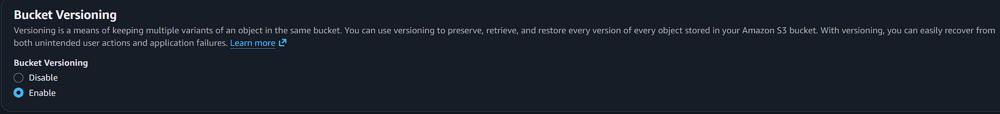

### 2.3 Configuración del Backend con S3 Native Locking

En `backend.tf` se declara el bloque del backend con la directiva `use_lockfile = true`:

```hcl
terraform {
  backend "s3" {
    bucket       = "tf-state-s3-ronald"
    key          = "back/terraform.tfstate"
    region       = "us-east-1"
    use_lockfile = true
  }
}
```

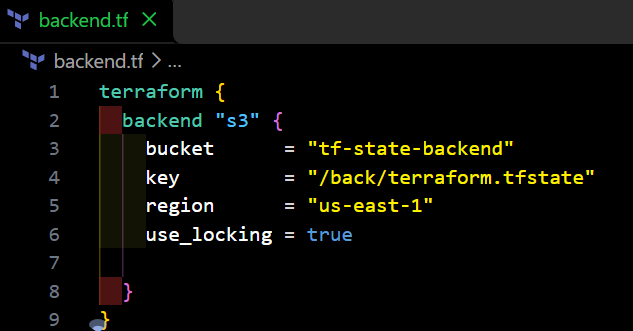

> **Ventaja de `use_lockfile = true`:** A partir de Terraform v1.10+, S3 soporta bloqueo de estado nativo mediante la creación y verificación de un archivo auxiliar `.tflock`. Esto elimina la necesidad histórica de aprovisionar y pagar una tabla dedicada de Amazon DynamoDB para evitar modificaciones concurrentes.

---

## Fase 3: Aprovisionamiento de Red (VPC) mediante Módulos

Para estructurar la red se adopta el módulo verificado de la comunidad en el Terraform Registry: [`terraform-aws-modules/vpc/aws`](https://registry.terraform.io/modules/terraform-aws-modules/vpc/aws/latest).

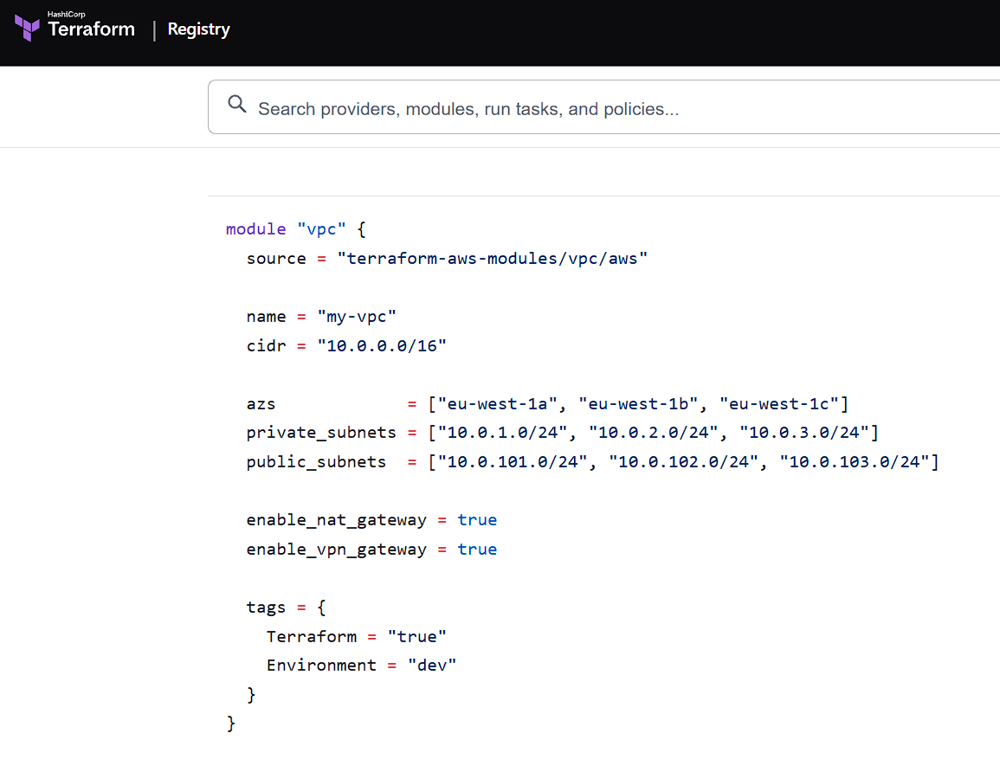

### 3.1 Vendorización local del módulo

En lugar de depender de la descarga remota del registro público en cada ejecución del pipeline, el módulo se vendorizó en el directorio local `modules/vpc/`. Esto asegura que el pipeline no sufra bloqueos por límites de cuota, caídas del Registry externo o cambios imprevistos en versiones de upstream.

En `main.tf` se invoca el módulo:

```hcl
module "vpc" {
  source = "./modules/vpc"

  name = "${local.prefix}-vpc"
  cidr = "10.0.0.0/16"

  azs             = ["us-east-1a", "us-east-1b"]
  private_subnets = ["10.0.1.0/24", "10.0.2.0/24"]
  public_subnets  = ["10.0.101.0/24", "10.0.102.0/24"]

  enable_nat_gateway = true
}
```

### 3.2 Despliegue Local Inicial (23 Recursos)

Se inicializa y aplica la configuración localmente:

```bash
terraform init
terraform apply
```

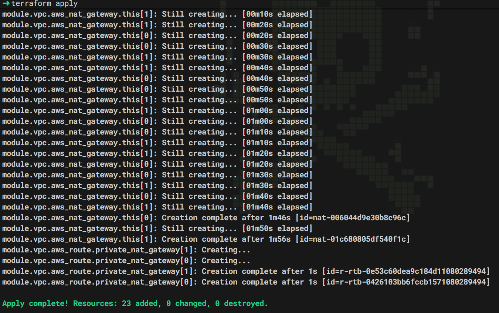

Terraform crea satisfactoriamente los 23 componentes de red: la VPC, 2 subredes públicas, 2 subredes privadas, tablas de enrutamiento, asociaciones de subred, Internet Gateway, Elastic IP y NAT Gateway.

### 3.3 Verificación en la Consola de AWS

Se comprueba que tanto el estado como los recursos físicos existen en AWS:

1. **Estado remoto en S3:** El archivo `terraform.tfstate` se encuentra en `s3://tf-state-s3-ronald/back/terraform.tfstate`.
   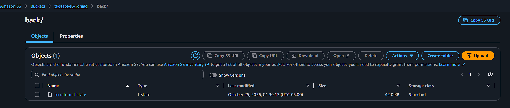
   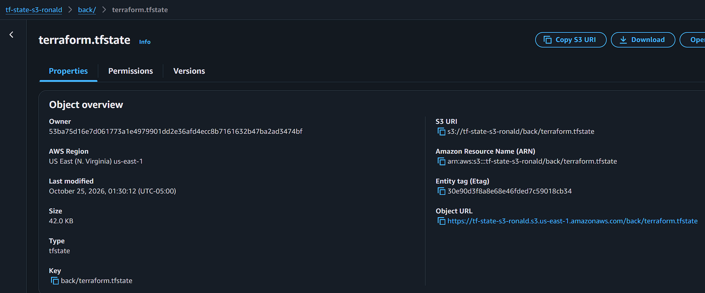

2. **Recursos de VPC en consola:** La VPC se encuentra activa con sus 4 subredes, tablas de enrutamiento y pasarelas de red.
   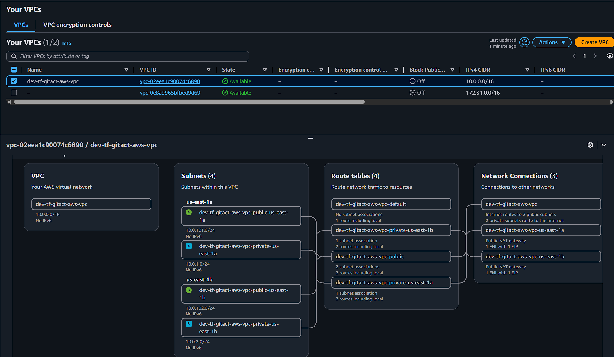

---

## Fase 4: Preparación y Versionado en Git

Para evitar subir archivos efímeros o sensibles a GitHub, se toma como base la plantilla oficial del repositorio [github/gitignore](https://github.com/github/gitignore/blob/main/Terraform.gitignore):

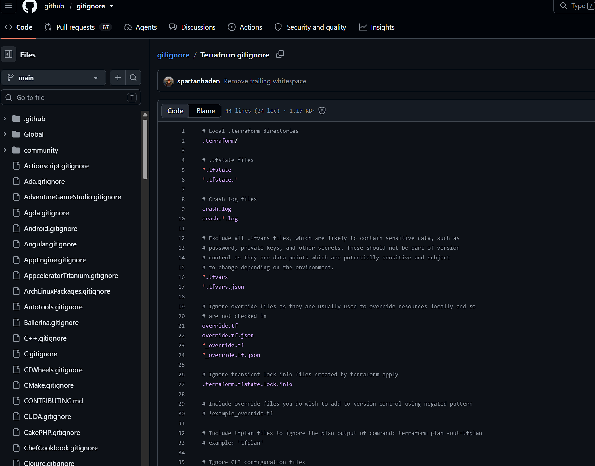

El archivo `.gitignore` del proyecto excluye:
* La caché de providers y plugins (`.terraform/`).
* Archivos de estado local y respaldos (`*.tfstate`, `*.tfstate.*`).
* Archivos de variables con potenciales secretos (`*.tfvars`, `*.tfvars.json`).
* Archivos temporales de bloqueo (`.terraform.tfstate.lock.info`).

El archivo de bloqueo determinista `.terraform.lock.hcl` **sí se incluye** en el control de versiones para asegurar que todos los entornos utilicen exactamente la misma versión del proveedor de AWS.

---

## Fase 5: Diseño del Pipeline CI/CD con GitHub Actions

### 5.1 Exploración y selección de plantillas

Desde la interfaz de GitHub Actions se analiza el catálogo de flujos de trabajo (*starter workflows*) y se selecciona la plantilla oficial de HashiCorp Terraform:

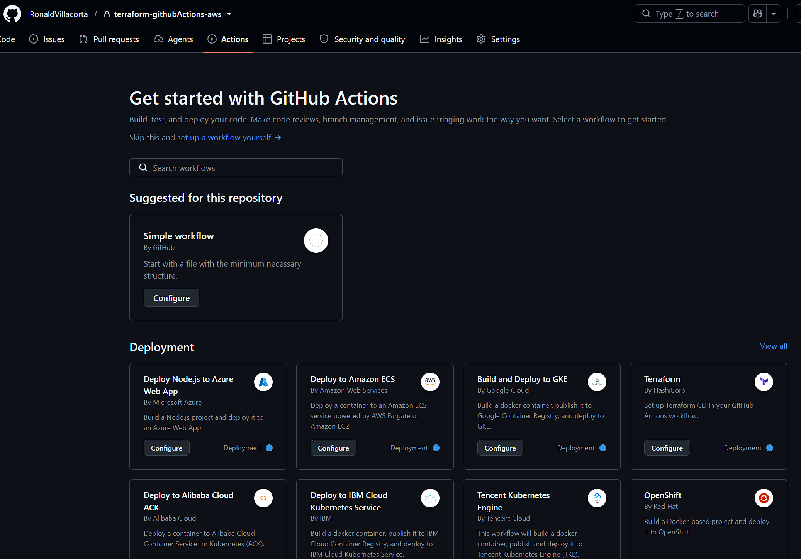
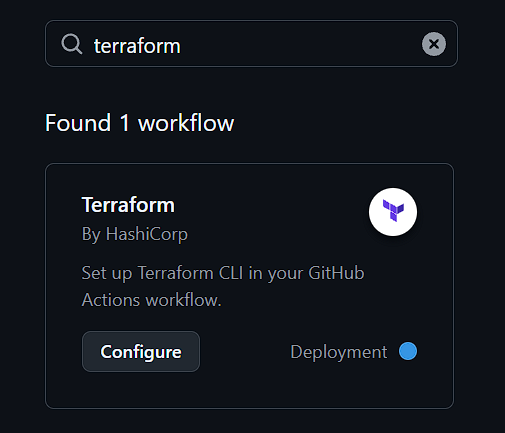

### 5.2 Auditoría y selección de versiones de Actions

Siguiendo principios de mantenimiento y seguridad, no se adoptan a ciegas las versiones predeterminadas de las plantillas. Se auditan los repositorios oficiales de cada Action:

* **`actions/checkout`:** La plantilla proponía `v4` (imagen `v4-checkout.png`). Se verifica en el Marketplace la versión más reciente (imagen `vers-checkout.png`) y se fija `actions/checkout@v7`.
* **`hashicorp/setup-terraform`:** La plantilla sugería `v1` (imagen `v-tf-plantilla.png`). Se constatan versiones posteriores en el repositorio oficial (imagen `v-tf-oficial.png`) y se opta por `hashicorp/setup-terraform@v4`.
* **`aws-actions/configure-aws-credentials`:** Se selecciona la versión mayor más reciente (`v6`) para dar soporte completo a tokens OIDC modernos.

### 5.3 Workflow Definitivo (.github/workflows/terraform.yml)

```yaml
name: Pipeline in Terraform

on:
  push:
    branches: 
      - main

permissions:
  contents: read
  id-token: write    # Requerido obligatoriamente para solicitar el token OIDC

jobs:
  terraform:
    runs-on: ubuntu-latest
    steps:
      - name: Checkout repository
        uses: actions/checkout@v7

      - name: Set up Terraform
        uses: hashicorp/setup-terraform@v4
        with:
          terraform_version: "1.16.6"

      - name: Configure AWS Credentials 
        uses: aws-actions/configure-aws-credentials@v6
        with:
          aws-region: us-east-1
          role-to-assume: arn:aws:iam::336203085137:role/github-actions-web-provider-role

      - name: Verify AWS Credentials
        run: aws sts get-caller-identity

      - name: Terraform init
        run: terraform init

      - name: Terraform apply
        run: terraform apply -auto-approve
```

---

## Fase 6: Autenticación Segura sin Claves mediante AWS OIDC e IAM

### ¿Por qué evitar GitHub Secrets con claves de acceso estáticas?

Almacenar un `AWS_ACCESS_KEY_ID` y un `AWS_SECRET_ACCESS_KEY` en los *Secrets* de GitHub conlleva riesgos:
1. Son credenciales permanentes que no expiran por sí solas.
2. Si un atacante compromete el repositorio o un colaborador malicioso imprime los secretos en el runner, la cuenta de AWS queda expuesta.
3. Requiere gestión manual de rotación periódica.

Con **OpenID Connect (OIDC)**:
* El runner de GitHub solicita a GitHub un token de identidad firmado digitalmente (JWT).
* AWS STS valida la firma criptográfica del token contra el proveedor de identidad OIDC de GitHub.
* AWS STS entrega credenciales temporales de corta duración (válidas por 1 hora) limitadas exclusivamente al rol solicitado.

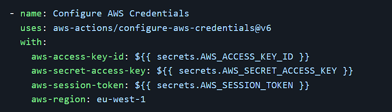

### 6.1 Configuración del Proveedor OIDC en AWS IAM

En la consola de IAM se accede a **Identity Providers**:

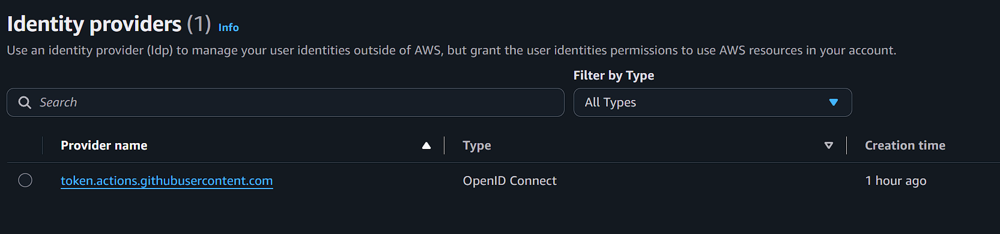

Se añade un proveedor de tipo **OpenID Connect** siguiendo las especificaciones oficiales de GitHub:
* **Provider URL:** `https://token.actions.githubusercontent.com`
* **Audience:** `sts.amazonaws.com`

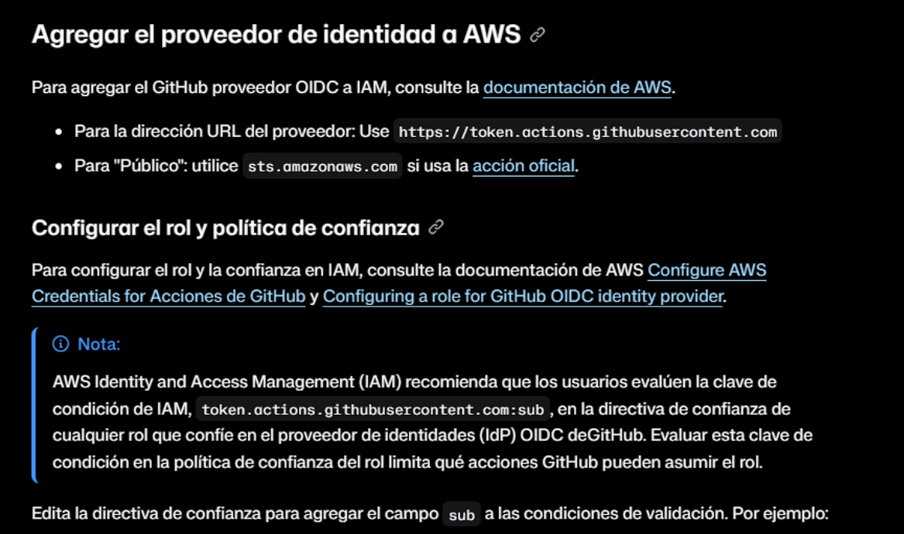
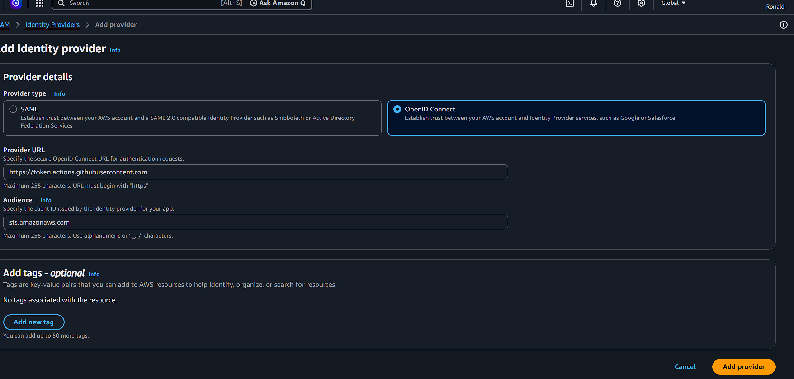

### 6.2 Creación del Rol IAM para GitHub Actions

Se crea el rol `github-actions-web-provider-role`:
1. **Tipo de entidad confiable:** Proveedor de identidad Web (`token.actions.githubusercontent.com`).
2. **Audiencia:** `sts.amazonaws.com`.

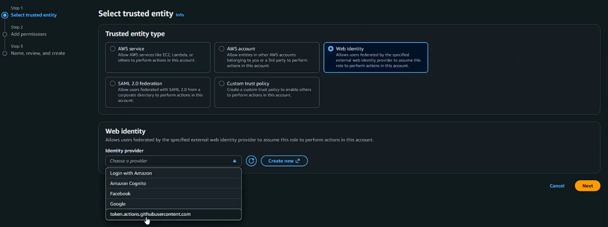
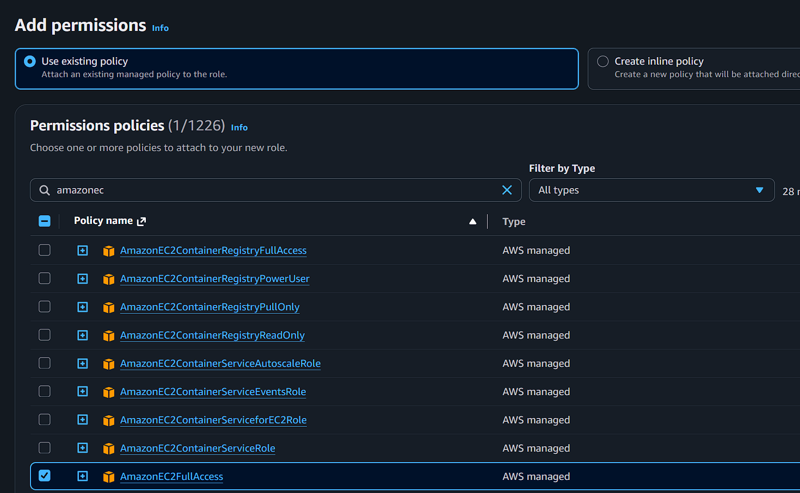
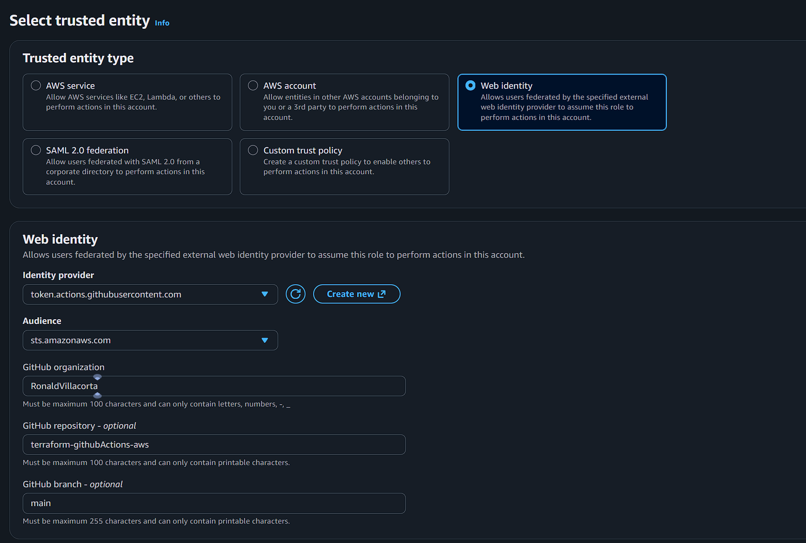
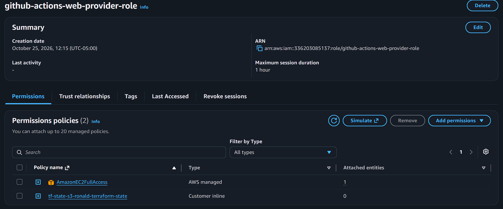

---

## Fase 7: Diagnóstico de Errores y Soluciones Técnicas (Troubleshooting)

Durante el primer push hacia la rama `main`, la ejecución del workflow se detuvo debido a errores sucesivos en las distintas capas de seguridad. Esta sección documenta el diagnóstico técnico y la resolución de cada incidente.

---

### 8.1 Error 1: Validación del audience en el token OIDC

#### Síntoma y Mensaje de Error:
```text
Could not assume role with OIDC:
The web identity token provided could not be validated.
```

#### Causa Raíz:
En el paso `aws-actions/configure-aws-credentials` del workflow se había especificado explícitamente:
```yaml
audience: https://sts.amazonaws.com
```
Sin embargo, para AWS comercial el valor canónico del claim `aud` es estrictamente `sts.amazonaws.com` (sin el prefijo `https://`). Dado que AWS compara este valor con el registrado en el Identity Provider, el token fue rechazado en la validación criptográfica inicial.

#### Solución Aplicada:
Se eliminó el parámetro `audience` del archivo del workflow, permitiendo que la acción `configure-aws-credentials` aplique por defecto el valor estándar `sts.amazonaws.com`.

---

### 8.2 Error 2: Desajuste del claim `sub` por identificadores inmutables de GitHub

#### Síntoma y Mensaje de Error:
```text
Not authorized to perform sts:AssumeRoleWithWebIdentity
```

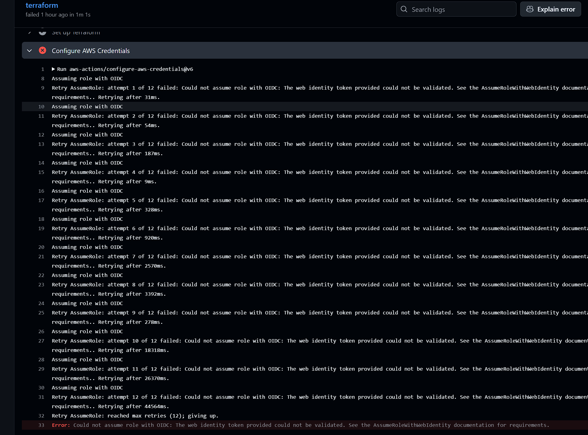

#### Causa Raíz:
La directiva de confianza (*Trust Policy*) del rol IAM evaluaba la condición de asunto (*Subject Claim* - `sub`) mediante el formato clásico documentado:

```json
"token.actions.githubusercontent.com:sub": "repo:RonaldVillacorta/terraform-githubActions-aws:ref:refs/heads/main"
```

No obstante, **a partir del 15 de julio de 2026**, los nuevos repositorios de GitHub emiten un claim `sub` con **identificadores inmutables** que incluyen el identificador numérico único del usuario y del repositorio para prevenir ataques de secuestro de nombres (*repo squatting*).

#### Diagnóstico del Token:
Para descubrir el contenido exacto del token JWT emitido por GitHub Actions, se inyectó temporalmente un script de inspección en el runner:

```python
import os, json, base64, urllib.request

url = os.environ["ACTIONS_ID_TOKEN_REQUEST_URL"] + "&audience=sts.amazonaws.com"
req = urllib.request.Request(
    url,
    headers={"Authorization": "Bearer " + os.environ["ACTIONS_ID_TOKEN_REQUEST_TOKEN"]}
)

with urllib.request.urlopen(req) as response:
    token = json.load(response)["value"]

payload = token.split(".")[1]
payload += "=" * (-len(payload) % 4)
claims = json.loads(base64.urlsafe_b64decode(payload))

print("ISS:", claims.get("iss"))
print("AUD:", claims.get("aud"))
print("SUB:", claims.get("sub"))
```

El script imprimió los claims reales:
* **ISS:** `https://token.actions.githubusercontent.com`
* **AUD:** `sts.amazonaws.com`
* **SUB:** `repo:RonaldVillacorta@132775200/terraform-githubActions-aws@1433395622:ref:refs/heads/main`

#### Solución Aplicada:
Se actualizó la Trust Policy del rol IAM en AWS con el claim inmutable exacto:

```json
{
  "Version": "2012-10-17",
  "Statement": [
    {
      "Effect": "Allow",
      "Principal": {
        "Federated": "arn:aws:iam::336203085137:oidc-provider/token.actions.githubusercontent.com"
      },
      "Action": "sts:AssumeRoleWithWebIdentity",
      "Condition": {
        "StringEquals": {
          "token.actions.githubusercontent.com:aud": "sts.amazonaws.com",
          "token.actions.githubusercontent.com:sub": "repo:RonaldVillacorta@132775200/terraform-githubActions-aws@1433395622:ref:refs/heads/main"
        }
      }
    }
  ]
}
```

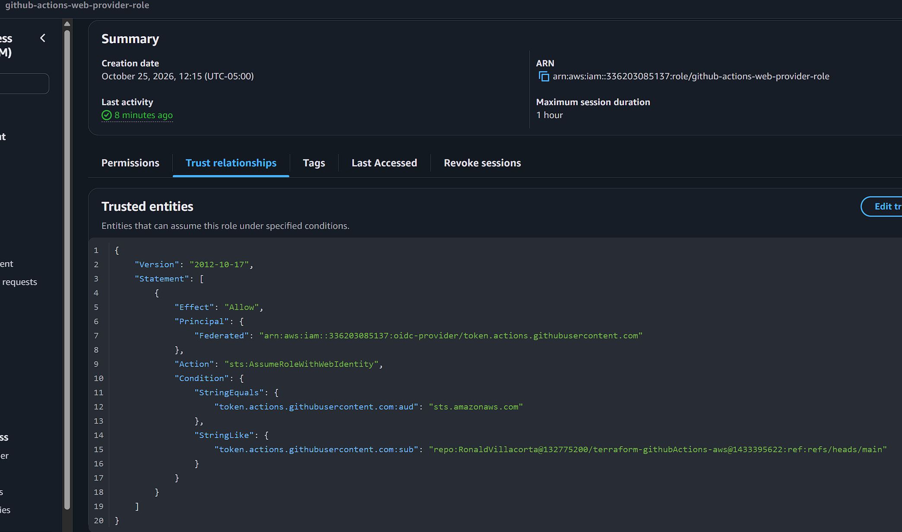

Resultado: El runner asumió exitosamente el rol IAM y superó la autenticación.

---

### 8.3 Error 3: Acceso denegado (403 Forbidden) en S3 HeadObject durante `terraform init`

#### Síntoma y Mensaje de Error:
```text
Error refreshing state:
Unable to access object "back/terraform.tfstate"
in S3 bucket "tf-state-s3-ronald"

S3: HeadObject
StatusCode: 403 Forbidden
```

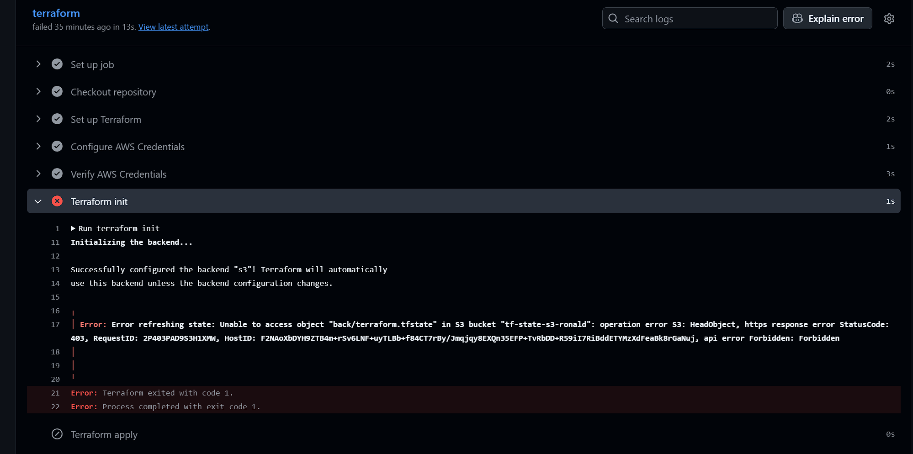

#### Causa Raíz:
Durante `terraform init`, Terraform realiza una petición `HeadObject` para verificar la existencia del archivo de estado y del archivo de bloqueo. Según la API de Amazon S3, cuando una identidad no cuenta con el permiso `s3:ListBucket`, cualquier consulta sobre un objeto inexistente o restringido responde con código HTTP `403 Forbidden` en lugar de `404 Not Found`.

Además, al utilizar la directiva **`use_lockfile = true`**, Terraform necesita crear y eliminar el archivo de bloqueo `.tflock` en la misma ruta del estado.

#### Solución Aplicada:
Se asoció al rol `github-actions-web-provider-role` una política en línea con permisos quirúrgicos de mínimo privilegio:

```json
{
  "Version": "2012-10-17",
  "Statement": [
    {
      "Sid": "AllowListBucketForStateVerification",
      "Effect": "Allow",
      "Action": "s3:ListBucket",
      "Resource": "arn:aws:s3:::tf-state-s3-ronald"
    },
    {
      "Sid": "AllowStateFileAccess",
      "Effect": "Allow",
      "Action": [
        "s3:GetObject",
        "s3:PutObject"
      ],
      "Resource": "arn:aws:s3:::tf-state-s3-ronald/back/terraform.tfstate"
    },
    {
      "Sid": "AllowNativeLockfileOperations",
      "Effect": "Allow",
      "Action": [
        "s3:GetObject",
        "s3:PutObject",
        "s3:DeleteObject"
      ],
      "Resource": "arn:aws:s3:::tf-state-s3-ronald/back/terraform.tfstate.tflock"
    }
  ]
}
```

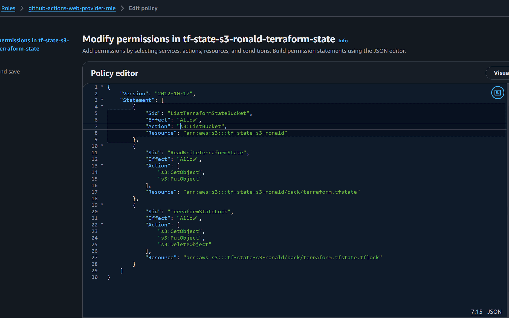

---

### 8.4 Diagnóstico sin Docker: inspección de JWT en el Runner

Durante la fase de depuración se intentó utilizar la acción comunitaria `github/actions-oidc-debugger@main`. No obstante, la acción falló al construir su contenedor Docker debido a una incompatibilidad de versiones en paquetes de Go dentro de Alpine Linux:

```text
ERROR: unable to select packages
go-1.24.13-r0:
  breaks: world[go=1.24.6-r0]
```

**Solución de ingeniería:** Se prescindió de imágenes Docker externas y se utilizó un script en Python ejecutado directamente sobre el sistema operativo del runner de GitHub (`ubuntu-latest`). Esto agilizó la depuración, redujo el tiempo de build y eliminó dependencias frágiles de terceros.

---

## Fase 8: Validación de Ejecución y Pruebas de Cambio

### 8.1 Ejecución Satisfactoria del Pipeline

Con las tres capas de seguridad corregidas (Token OIDC, Trust Policy y Permisos S3), se ejecutó un nuevo `git push`. El pipeline completó todas las fases en verde:

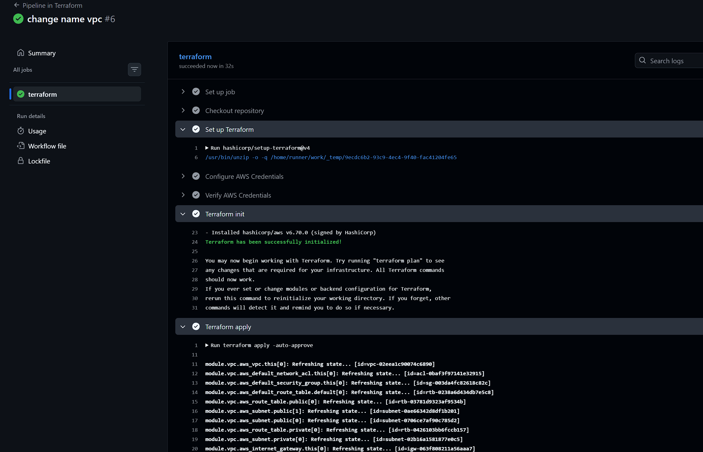

### 8.2 Prueba de Modificación y Despliegue Continuo (CD)

Para validar la idempotencia y la capacidad de actualización continua del pipeline:
1. Se modificó el archivo `main.tf` actualizando el nombre de la VPC a:
   ```hcl
   name = "${local.prefix}-vpc-v2"
   ```
2. Se hizo commit y push a la rama `main`.
3. GitHub Actions detectó la modificación, ejecutó `terraform apply -auto-approve` y actualizó las etiquetas de los recursos en AWS sin interrumpir la conectividad ni duplicar elementos.

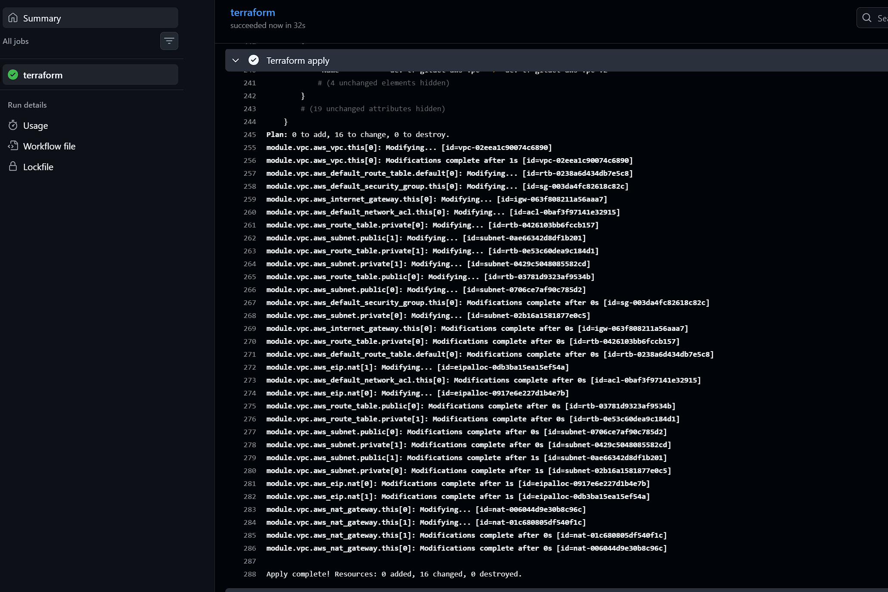

---

## Estructura del Repositorio

```text
tf-gitact-aws/
├── .github/
│   └── workflows/
│       └── terraform.yml               # Definición del pipeline CI/CD de GitHub Actions
├── .gitignore                          # Exclusión de archivos sensibles, estados y cachés
├── .terraform.lock.hcl                 # Control determinista de dependencias de proveedores
├── README.md                           # Memoria técnica completa del proyecto
├── backend.tf                          # Configuración de backend remoto S3 y bloqueo nativo
├── locals.tf                           # Variables locales, prefijos y default tags
├── main.tf                             # Invocación y orquestación del módulo de red VPC
├── provider.tf                         # Declaración de versiones de Terraform y AWS Provider
├── problems-credentials.md             # Notas y script de diagnóstico del token JWT OIDC
├── images/                             # Diagramas de arquitectura y capturas probatorias
└── modules/
    └── vpc/                            # Módulo oficial de VPC vendorizado localmente
        ├── main.tf
        ├── outputs.tf
        └── variables.tf
```

### Tabla Descriptiva de Componentes

| Archivo / Carpeta | Función Técnica |
|---|---|
| `.github/workflows/terraform.yml` | Pipeline de GitHub Actions que gestiona la autenticación OIDC, `terraform init` y `terraform apply`. |
| `backend.tf` | Configura el backend remoto en el bucket `tf-state-s3-ronald` y habilita `use_lockfile = true`. |
| `locals.tf` | Centraliza el prefijo de nomenclatura (`dev-tf-gitact-aws`) y las etiquetas globales (`Owner: Ronald`, `ManagedBy: Terraform`). |
| `main.tf` | Archivo raíz que declara el módulo `vpc` con subredes multi-AZ y NAT Gateway. |
| `provider.tf` | Restringe Terraform `>= 1.16.6` y fija el proveedor `hashicorp/aws` en `6.70.0`. |
| `modules/vpc/` | Código fuente del módulo de red vendorizado localmente para garantizar estabilidad de compilación. |
| `problems-credentials.md` | Documentación técnica interna y script Python para decodificación de claims OIDC. |
| `images/` | Evidencias visuales de consola, terminal y diagrama de arquitectura `infraestructura.png`. |

---

## Decisiones Técnicas Relevantes

| Decisión Técnica | Justificación y Beneficio |
|---|---|
| **Federación OIDC vs. Secrets** | Elimina claves de acceso estáticas de larga duración. Los tokens JWT son efímeros y se autorizan mediante políticas de confianza criptográficas. |
| **S3 Native Locking (`use_lockfile = true`)** | Aprovecha la funcionalidad moderna de Terraform para bloquear el estado directamente en S3 sin necesidad de pagar ni configurar Amazon DynamoDB. |
| **Versionamiento en S3** | Proporciona un historial inmutable de cada versión del estado (`terraform.tfstate`), habilitando recuperación ante desastres (*disaster recovery*). |
| **Vendorización de Módulos (`modules/vpc`)** | Protege el pipeline frente a fallas de red externas, rate limits del Terraform Registry o cambios abruptos en versiones upstream. |
| **Claims Inmutables en IAM Trust Policy** | Cumple con el estándar de seguridad de GitHub (julio 2026), vinculando la autorización al Owner ID y Repo ID para evitar vulnerabilidades de suplantación. |
| **Mínimo Privilegio en S3** | En lugar de utilizar `AmazonS3FullAccess`, se autorizó estrictamente `s3:ListBucket` y las rutas exactas del `.tfstate` y `.tflock`. |
| **`default_tags` en Provider** | Garantiza trazabilidad de costos y gobernanza asignando automáticamente etiquetas a todos los recursos creados. |

---

## Lecciones Aprendidas para Ingeniería DevOps

1. **OIDC y Permisos IAM operan en capas independientes:**  
   La directiva de confianza (*Trust Policy*) valida **quién** tiene permitido asumir el rol (autenticación). Las directivas de permisos (*Identity-based policies*) definen **qué acciones** puede ejecutar ese rol sobre los recursos de AWS (autorización).
2. **Precisión estricta en los Claims de Identidad:**  
   El valor de `aud` no debe llevar protocolo (`sts.amazonaws.com`), y el claim `sub` debe coincidir de forma binaria con la identidad emitida por el proveedor OIDC.
3. **Comportamiento de la API S3 HeadObject:**  
   En AWS S3, una consulta de verificación de objeto devuelve `403 Forbidden` en lugar de `404 Not Found` si la identidad carece de permisos de listado (`s3:ListBucket`) a nivel del bucket.
4. **Dependencias en Pipelines:**  
   Evitar el uso de herramientas empaquetadas en imágenes Docker complejas cuando una tarea diagnóstica se puede resolver de manera limpia con scripts estándar (Python, Bash) en el runner.

---

## Posibles Mejoras y Roadmap hacia Producción

Para continuar evolucionando este pipeline hacia una madurez enterprise:

1. **Separación de Flujos (Plan en PR, Apply en Main):**  
   Configurar el pipeline para que ejecute `terraform plan` y publique los resultados como un comentario en los Pull Requests, reservando `terraform apply` exclusivamente para fusiones en `main`.
2. **Ambientes Protegidos (*GitHub Environments*):**  
   Implementar reglas de aprobación manual obligatoria (*Reviewers*) antes de que se ejecute el despliegue sobre entornos productivos.
3. **Escaneo de Vulnerabilidades y Cumplimiento IaC:**  
   Integrar escáneres estáticos de seguridad en el pipeline (por ejemplo, **Trivy**, **Checkov** o **tfsec**) para bloquear despliegues que introduzcan configuraciones inseguras.
4. **Estrategia Multi-Entorno:**  
   Parametrizar el código mediante Terraform Workspaces o carpetas de entorno (`dev/`, `staging/`, `prod/`), asignando diferentes roles IAM y buckets S3 para cada ambiente.

---

## Referencias Oficiales

- [GitHub Docs — Configuring OpenID Connect in Amazon Web Services](https://docs.github.com/en/actions/deployment/security-hardening-your-deployments/configuring-openid-connect-in-amazon-web-services)
- [AWS Actions — Configure AWS Credentials Action for GitHub Actions](https://github.com/aws-actions/configure-aws-credentials)
- [AWS Documentation — Creating an IAM OIDC Identity Provider](https://docs.aws.amazon.com/IAM/latest/UserGuide/id_roles_providers_create_oidc.html)
- [Terraform Documentation — AWS S3 Backend Configuration](https://developer.hashicorp.com/terraform/language/backend/s3)
- [Terraform Registry — AWS VPC Module](https://registry.terraform.io/modules/terraform-aws-modules/vpc/aws/latest)
- [AWS Documentation — Troubleshooting 403 Forbidden Errors in S3](https://repost.aws/knowledge-center/s3-troubleshoot-403)
